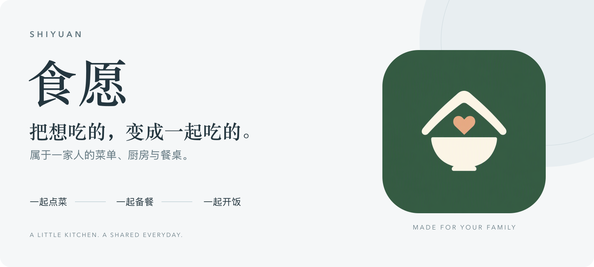
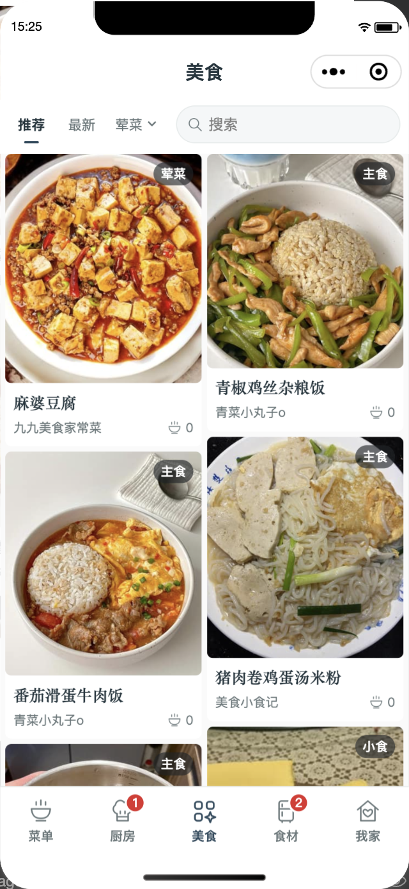
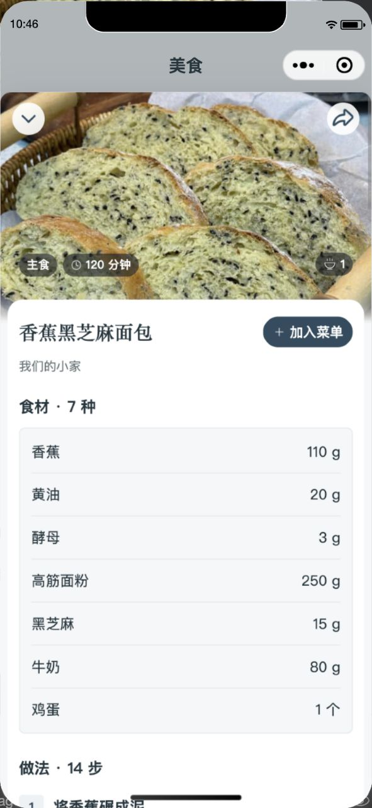

<picture>
  <source media="(max-width: 640px) and (prefers-color-scheme: dark)" srcset="docs/images/readme/cover-compact-dark.png" />
  <source media="(max-width: 640px)" srcset="docs/images/readme/cover-compact.png" />
  <source media="(prefers-color-scheme: dark)" srcset="docs/images/readme/cover-dark.png" />
  
</picture>

<p align="center">
  <a href="docs/版本与发布.md"></a>
  
  
  
</p>

<p align="center">
  <a href="#看看食愿">界面预览</a> ·
  <a href="#一家人的日常">功能介绍</a> ·
  <a href="#开始开发">开始开发</a> ·
  <a href="docs/开发接手指南.md">开发文档</a>
</p>

## 关于食愿

**食愿是一款围绕家庭日常做饭设计的微信小程序。**

把常做的菜收进自家菜单，把家人想吃的菜安排成一餐，再一起备菜、整理采购、开饭。菜谱、餐食安排和食材清单放在一起，家里负责点菜和负责做饭的人，都能找到自己需要的内容。

也可以去「美食」看看别人家的拿手菜：找到喜欢的做法，加入自家菜单，再按家人的口味慢慢调整。

> 一道菜可以反复做，一家人的菜单可以慢慢长大。

## 看看食愿

<table>
  <tr>
    <td width="50%" align="center"><strong>发现下一道想吃的菜</strong></td>
    <td width="50%" align="center"><strong>把食材和做法看明白</strong></td>
  </tr>
  <tr>
    <td align="center"><a href="docs/images/readme/discover.png"></a></td>
    <td align="center"><a href="docs/images/readme/recipe.png"></a></td>
  </tr>
  <tr>
    <td align="center">推荐与最新 · 分类搜索 · 加入菜单</td>
    <td align="center">用量清楚 · 图文步骤 · 保留来源</td>
  </tr>
</table>

<p align="center"><sub>真实微信开发者工具界面，连接现有云数据。点击图片可查看大图。</sub></p>

## 一家人的日常

| 入口 | 能做什么 |
| --- | --- |
| **菜单** | 收藏家里常吃的菜，按分类浏览和搜索；编辑菜品、食材用量与图文做法，也能把几道菜组合成套餐。 |
| **厨房** | 安排今天、明天、后天的餐食，查看家人选了什么；按菜确认备菜、调整本餐用量，再记录开饭。 |
| **美食** | 浏览推荐与最新分享，按分类寻找做菜灵感；把喜欢的菜加入自家菜单，分享自己的拿手菜。 |
| **食材** | 主动把本餐需要的食材加入采购，按餐或按菜查看；可选开启冰箱，按冷藏、冷冻、常温管理库存。 |
| **我家** | 创建、加入与切换家庭，设置名称和封面，邀请家人、管理成员；每个家庭都有独立的菜单与餐食安排。 |

### 从想吃，到开饭

**挑选菜品 → 安排一餐 → 按菜备料 → 整理采购 → 一起开饭**

- **照顾一家人的选择。** 菜品和套餐可以一起点，同一餐汇总到厨房，保留家人的选择。
- **这一餐，按这一餐来。** 备菜时可调整实际用量，采购清单跟随本餐安排；不必为了做一顿饭反复改原菜谱。
- **好做法留在自己家。** 加入菜单后得到可独立编辑的副本，原分享与来源署名仍保留。
- **记住平常的一顿饭。** 通过开火日记回看餐食，让日常的家常菜也有记录。

### 做饭时用得上的细节

- 食材用量以数量和单位表达，保留「适量」「少许」这样的常见烹饪写法。
- 图文做法按步骤展开，列表与详情使用适合各自场景的图片尺寸。
- 推荐流采用双列布局，封面高度差保持克制，让浏览节奏更稳定。
- 好友分享与公开发布分开，家庭协作和美食交流有各自的入口。
- 冰箱可按家庭习惯开启；采购也可以独立使用。

食愿目前聚焦家庭点餐、做饭与食材安排。采购清单用于备餐整理，暂未接入真实支付、配送和自动下单。

## 项目构成

食愿采用 **Vue 3 + uni-app** 构建微信小程序，通过 **微信云开发 / CloudBase** 提供家庭协作、数据存储和图片服务。

| 部分 | 说明 |
| --- | --- |
| 小程序界面 | Vue 3 组件、uni-app 微信端、统一视觉与交互约定 |
| 业务规则 | 独立领域模块，管理家庭、菜谱、餐单、备菜、采购与分享 |
| 云端服务 | Node.js 云函数、微信可信身份、家庭权限校验、云数据库与云存储 |
| 图片体验 | 本机压缩、列表与详情图、缓存、按需加载和私有媒体处理 |
| 工程保障 | 锁定依赖、自动化测试、微信原生产物检查、版本与发布校验 |

## 开始开发

有私有仓库访问权限后，可以下载源码并恢复开发环境：

```sh
git clone https://github.com/pydaxing/shiyuan.git
cd shiyuan
npm ci
cp .env.example .env.production
```

在 `.env.production` 填写正式 AppID、云环境和云函数配置，再运行：

```sh
npm run build:release
```

使用微信开发者工具打开 **`dist/release`**，登录有开发权限的微信账号进行真实云数据预览。已验证的工具环境、配置来源、常用命令和上传工具要求，见 **[开发接手指南](docs/开发接手指南.md)**。

仓库保存源码与项目资源。数据库、云存储、账号登录和本机私有配置各自维护；换电脑时需要恢复配置与工具登录。新的 Codex 可从 [AGENTS.md](AGENTS.md) 开始理解项目。

## 文档导航

| 文档 | 适合什么时候阅读 |
| --- | --- |
| [开发接手指南](docs/开发接手指南.md) | 换电脑、换会话，或第一次加入开发 |
| [交互约定](UX-CONTRACT.md) | 修改餐食流程、数据行为与页面交互 |
| [设计规范](DESIGN.md) | 调整布局、颜色、组件与视觉细节 |
| [云端部署](docs/正式云端部署.md) | 核对云环境、数据库规则与云函数部署 |
| [版本与发布](docs/版本与发布.md) | 更新版本号、校验构建与准备微信上传 |
| [首页素材维护](docs/项目首页维护.md) | 更新封面、截图与顶部徽章 |
| [开发协作](CONTRIBUTING.md) | 反馈问题、提出改进、提交代码 |

## 反馈与协作

有仓库权限的伙伴可以通过 [Issues](https://github.com/pydaxing/shiyuan/issues) 记录问题与想法。描述遇到问题的页面、操作步骤、期望结果和实际表现，会让修复更快；截图请先遮挡个人资料和家庭邀请码。

准备修改代码时，从 [开发协作](CONTRIBUTING.md) 开始。希望每一次改进，都让一家人更轻松地决定吃什么、一起把饭做好。

<br />

<p align="center"><strong>食愿 · 好好吃饭，一起生活。</strong></p>
