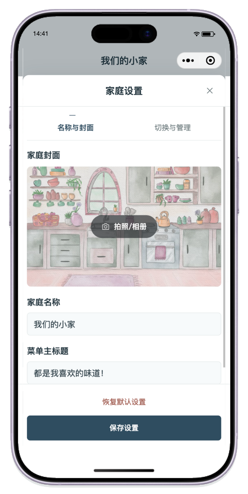
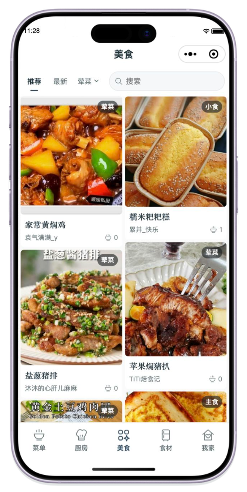
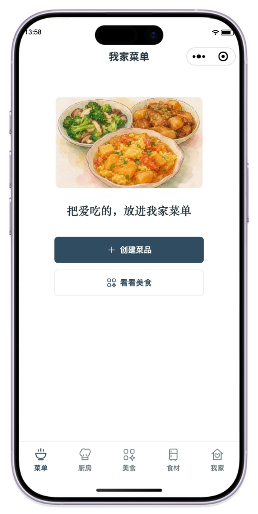
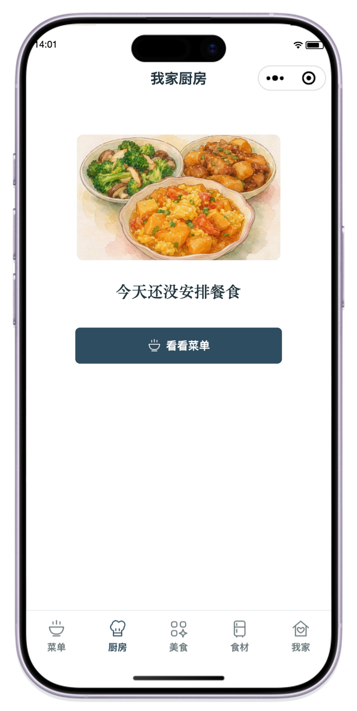
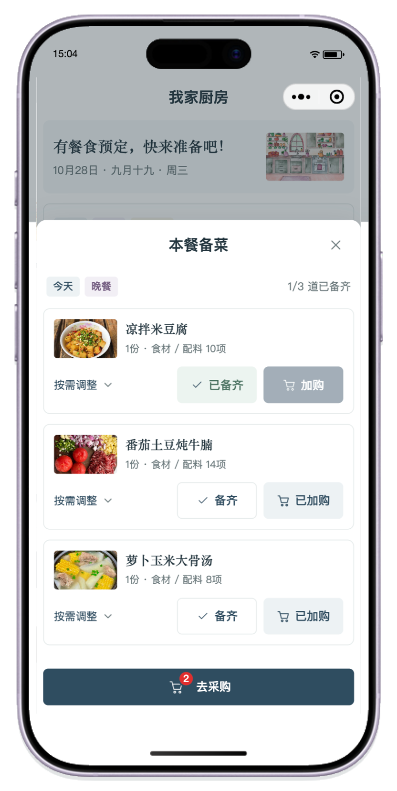
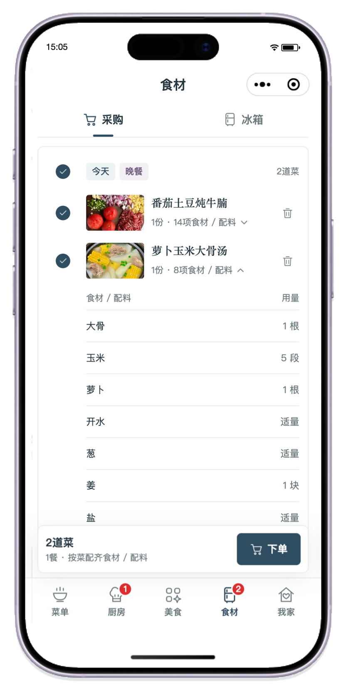
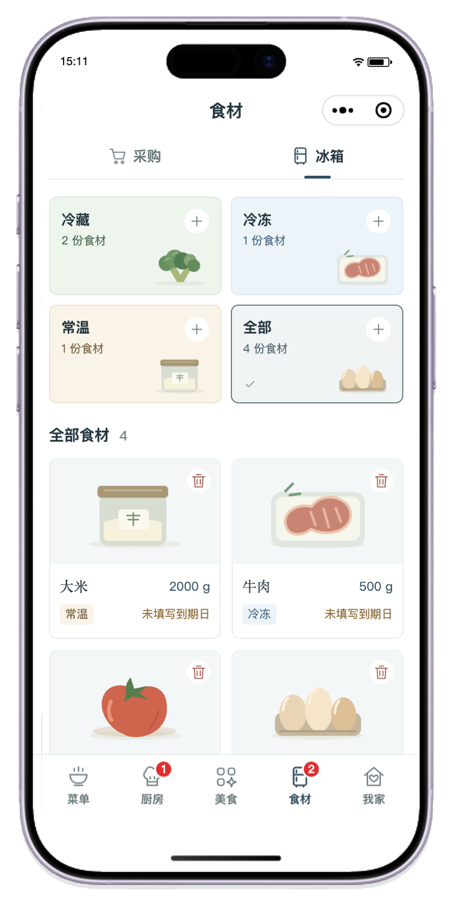
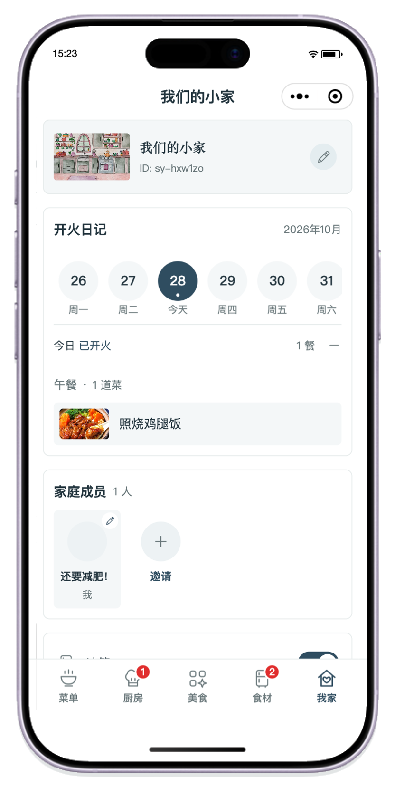

<picture>
  <source media="(max-width: 600px)" srcset="docs/images/promotion/readme-cta-top-compact.png" />
  
</picture>

<p align="center">
  <strong>打开微信 → 搜索小程序「食愿小灶」</strong><br />
  也可以用微信扫一扫上方小程序码；同一台手机浏览时，可保存<a href="docs/images/promotion/mini-program-code-1280.jpg">小程序码原图</a>，在微信扫一扫中从相册识别。
</p>

<p align="center">
  <a href="docs/版本与发布.md"></a>
  
  
  
</p>

<p align="center">
  <a href="#体验食愿小灶">小程序体验</a> ·
  <a href="#看看食愿">界面预览</a> ·
  <a href="#一家人的日常">功能介绍</a> ·
  <a href="#开始开发">开始开发</a> ·
  <a href="docs/开发接手指南.md">开发文档</a>
</p>

## 关于食愿

> 「今天吃啥？」
> 「都行，你定。」
> 到了晚上，又是同样的问题。

两个人也好，一家人也好，每天吃什么，是一个小问题，却要每天重新做决定。想吃的人一时没有主意，做饭的人除了下厨，还要想菜单、记住大家的口味、确认材料够不够。

**食愿是一款围绕家庭日常做饭设计的微信小程序，让「今天吃什么」变成一家人可以一起完成的选择。**

把喜欢的菜收进自家菜单，家人挑选想吃的菜，在厨房汇成同一餐，再按菜准备食材。负责点菜的人有具体的选择，负责做饭的人能看到这一餐的安排；菜谱、用量和采购清单也有了共同的去处。

没有灵感时，就去「美食」看看别人家的拿手菜。喜欢的做法可以加入自家菜单，按家人的口味修改；自己做得好的菜也可以分享出去。一家人的菜单，就这样随着每一次发现、尝试和调整，慢慢丰富起来。

> 把想吃的，变成一起吃的。让好好吃饭这件事，少一些纠结，多一些参与。

## 看看食愿

页面内容来自微信开发者工具中连接真实云数据的截图，与 **iPhone 17 标准版边框合成**为下方效果图。左右滑动浏览完整页面，点击图片查看大图。

<table>
  <thead>
    <tr>
      <th width="280" align="center" nowrap>属于一家人的食愿</th>
      <th width="280" align="center" nowrap>美食 · 发现想吃的</th>
      <th width="280" align="center" nowrap>菜单 · 留下喜欢的</th>
      <th width="280" align="center" nowrap>厨房 · 安排一起吃的</th>
      <th width="280" align="center" nowrap>备菜 · 按餐准备</th>
      <th width="280" align="center" nowrap>采购 · 按菜整理</th>
      <th width="280" align="center" nowrap>冰箱 · 记住家里有的</th>
      <th width="280" align="center" nowrap>我家 · 留下开火日常</th>
    </tr>
  </thead>
  <tbody>
    <tr>
      <td width="280" align="center" nowrap><a href="docs/images/readme/family-cover-phone.png"></a></td>
      <td width="280" align="center" nowrap><a href="docs/images/readme/discover-phone.png"></a></td>
      <td width="280" align="center" nowrap><a href="docs/images/readme/menu-phone.png"></a></td>
      <td width="280" align="center" nowrap><a href="docs/images/readme/kitchen-phone.png"></a></td>
      <td width="280" align="center" nowrap><a href="docs/images/readme/preparation-phone.png"></a></td>
      <td width="280" align="center" nowrap><a href="docs/images/readme/shopping-phone.png"></a></td>
      <td width="280" align="center" nowrap><a href="docs/images/readme/fridge-phone.png"></a></td>
      <td width="280" align="center" nowrap><a href="docs/images/readme/family-diary-phone.png"></a></td>
    </tr>
    <tr>
      <td align="center" nowrap>起个喜欢的家庭名，再选一张温暖的封面</td>
      <td align="center" nowrap>逛逛别人家的拿手菜，发现下一道想吃的</td>
      <td align="center" nowrap>把家人喜欢的每道菜，慢慢收进自家菜单</td>
      <td align="center" nowrap>汇总家人今天想吃的，一起安排好这一餐</td>
      <td align="center" nowrap>按这一餐调整食材量，逐道确认备菜进度</td>
      <td align="center" nowrap>想好做什么再买什么，按菜整理采购清单</td>
      <td align="center" nowrap>冷藏冷冻常温分开记，看看家里还有什么</td>
      <td align="center" nowrap>展开一餐一饭的记录，留下家里开火日常</td>
    </tr>
  </tbody>
</table>

## 一家人的日常

### 从想吃，到开饭

**挑选菜品 → 安排一餐 → 按菜备料 → 整理采购 → 一起开饭**

- **把「都行」变成具体的选择。** 家人从自己的菜单里挑菜，也能选择搭配好的套餐。同一餐汇总到厨房，想吃什么、谁选了什么，都有地方查看。
- **用量跟着这一餐走。** 做饭前可调整本餐的食材和配料，确认哪道菜已经备齐。临时少做一点、多放一点，都不用改掉原来的菜谱。
- **买什么，先从做什么开始。** 把需要采购的菜主动加入清单，按餐、按菜查看对应材料，保留每道菜的用量，少一些临到买菜时的猜测。
- **好做法，慢慢变成自家的拿手菜。** 美食加入菜单后得到可独立编辑的副本，来源仍保留。以后再做，可以沿用家里喜欢的版本；开火日记也能留下平常每一餐的记录。

### 五个入口，各有一件日常事

| 入口 | 能做什么 |
| --- | --- |
| **菜单** | 收藏家里常吃的菜，按分类浏览和搜索；编辑菜品、食材用量与图文做法，也能把几道菜组合成套餐。 |
| **厨房** | 安排今天、明天、后天的餐食，查看家人选了什么；按菜确认备菜、调整本餐用量，再记录开饭。 |
| **美食** | 浏览推荐与最新分享，按分类寻找做菜灵感；把喜欢的菜加入自家菜单，分享自己的拿手菜。 |
| **食材** | 主动把本餐需要的食材加入采购，按餐或按菜查看；可选开启冰箱，按冷藏、冷冻、常温管理库存。 |
| **我家** | 创建、加入与切换家庭，设置名称和封面，邀请家人、管理成员；每个家庭都有独立的菜单与餐食安排。 |

冰箱是可选的家庭工具，采购清单也可以独立使用。当前的采购能力用于整理备餐所需材料，真实下单、支付和配送尚未接入。

## 接下来，还想做好这些事

食愿先把共同选菜、安排餐食、按菜备料这条日常流程做好，再逐步扩展一餐饭前后的服务。**以下为后续规划，尚未成为当前版本的功能。**

| 方向 | 想解决的问题 | 后续设想 |
| --- | --- | --- |
| **按菜采购，按量准备** | 菜想好了，买菜时却容易凭感觉多买，或者买回了用不上的材料。 | 在现有按菜食材清单的基础上对接采购服务，让菜品、所需用量和可购买的食材衔接起来，帮助控制采购量，减少剩余和浪费。 |
| **AI 选餐与推荐** | 每天还是会有不想翻菜单、也不知道吃什么的时候。 | 结合家庭偏好与用餐需求，提供可以继续挑选、调整的菜品和餐食建议。 |
| **AI 餐食搭配与健康分析** | 单道菜会做了，一整餐怎样搭配更合适，却不容易判断。 | 围绕食材组成、营养与搭配提供分析和建议，让日常餐食更丰富，也更便于关注饮食均衡。 |

这些方向会随着实际使用反馈继续调整。希望未来的食愿，既能帮人决定吃什么，也能让准备一餐饭更有把握。

## 项目构成

食愿采用 **Vue 3 + uni-app** 构建微信小程序，通过 **微信云开发 / CloudBase** 提供家庭协作、数据存储和图片服务。

| 部分 | 说明 |
| --- | --- |
| 小程序界面 | Vue 3 组件、uni-app 微信端、统一视觉与交互约定 |
| 业务规则 | 独立领域模块，管理家庭、菜谱、餐单、备菜、采购与分享 |
| 云端服务 | Node.js 云函数、微信可信身份、家庭权限校验、云数据库与云存储 |
| 图片体验 | 本机压缩、列表与详情图、缓存、按需加载和私有媒体处理 |
| 工程保障 | 锁定依赖、自动化测试、微信原生产物检查、版本与发布校验 |

## 开始开发

仓库已公开，可以下载源码并安装依赖：

```sh
git clone https://github.com/pydaxing/shiyuan.git
cd shiyuan
npm ci
cp .env.example .env.production
```

独立开发请使用**自己的微信小程序 AppID 与 CloudBase 云环境**，在 `.env.production` 填写配置，并同步调整 `cloudbaserc.json` 的云环境与函数名称，再运行：

```sh
npm run build:release
```

按 [云端部署](docs/正式云端部署.md) 在自己的云环境准备数据库规则、索引及云函数后，使用微信开发者工具打开 **`dist/release`**，登录有开发权限的微信账号进行真实云数据预览。已验证的工具环境、配置来源、常用命令和上传工具要求，见 **[开发接手指南](docs/开发接手指南.md)**。

仓库保存源码与项目资源。数据库、云存储、账号登录和本机私有配置各自维护；换电脑时需要恢复配置与工具登录。新的 Codex 可从 [AGENTS.md](AGENTS.md) 开始理解项目。

项目自有软件代码与配套技术文档采用 **[MIT License](LICENSE)**，欢迎学习、修改、商用和再分发，使用时请保留版权与许可声明。品牌、小程序码、图片与宣传素材、菜谱及用户内容不包含在本次代码授权中；第三方依赖保留原许可。具体范围见 **[许可说明](LICENSING.md)**。

## 文档导航

| 文档 | 适合什么时候阅读 |
| --- | --- |
| [开发接手指南](docs/开发接手指南.md) | 换电脑、换会话，或第一次加入开发 |
| [交互约定](UX-CONTRACT.md) | 修改餐食流程、数据行为与页面交互 |
| [设计规范](DESIGN.md) | 调整布局、颜色、组件与视觉细节 |
| [云端部署](docs/正式云端部署.md) | 核对云环境、数据库规则与云函数部署 |
| [版本与发布](docs/版本与发布.md) | 更新版本号、校验构建与准备微信上传 |
| [发布版本台账](docs/发布版本台账.md) | 查询微信版本对应的 Git 标签、源码提交和已核验发布阶段 |
| [首页素材维护](docs/项目首页维护.md) | 更新封面、截图与顶部徽章 |
| [宣传素材](docs/images/promotion/README.md) | 下载小程序码、分享封面和宣传海报 |
| [推广与增长](docs/推广与增长.md) | 查看推广计划、渠道建议与介绍文案 |
| [开发协作](CONTRIBUTING.md) | 反馈问题、提出改进、提交代码 |

## 反馈与协作

欢迎通过 [Issues](https://github.com/pydaxing/shiyuan/issues/new/choose) 记录问题与想法。描述遇到问题的页面、操作步骤、期望结果和实际表现，会让修复更快；截图请先遮挡个人资料和家庭邀请码。

准备修改代码时，从 [开发协作](CONTRIBUTING.md) 开始。希望每一次改进，都让一家人更轻松地决定吃什么、一起把饭做好。

## 体验食愿小灶

今晚吃什么，可以从一家人都想吃的一道菜开始。打开微信，搜索小程序 **「食愿小灶」**，或者扫一扫下面的小程序码。

<picture>
  <source media="(max-width: 600px)" srcset="docs/images/promotion/readme-cta-bottom-compact.png" />
  
</picture>

<p align="center">
  <a href="docs/images/promotion/mini-program-code-1280.jpg">查看小程序码</a> ·
  <a href="docs/images/promotion/poster.png">保存宣传海报</a> ·
  <a href="https://github.com/pydaxing/shiyuan/issues/new/choose">反馈使用感受</a><br />
  如果食愿对你有帮助，欢迎 Star 关注后续进展，也欢迎把它分享给每天一起商量吃什么的人。
</p>

<p align="center"><strong>食愿 · 好好吃饭，一起生活。</strong></p>
