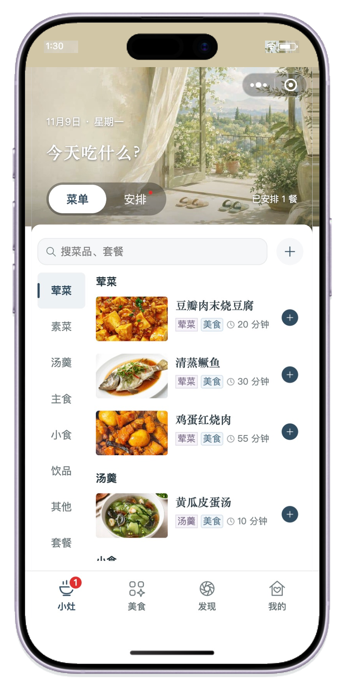
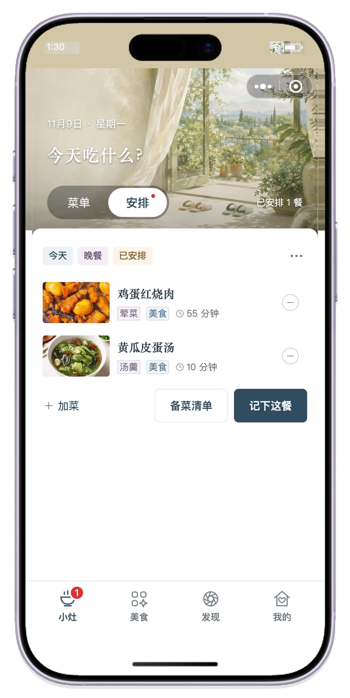
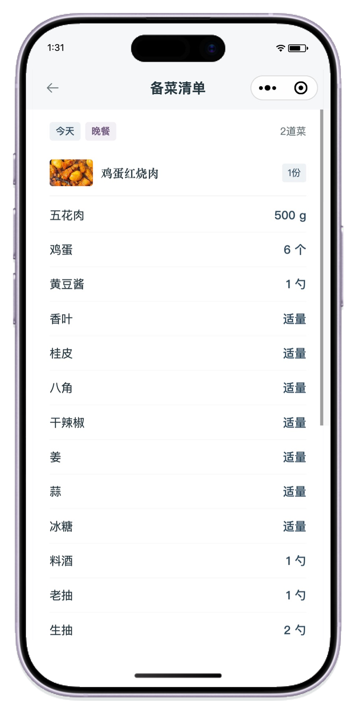
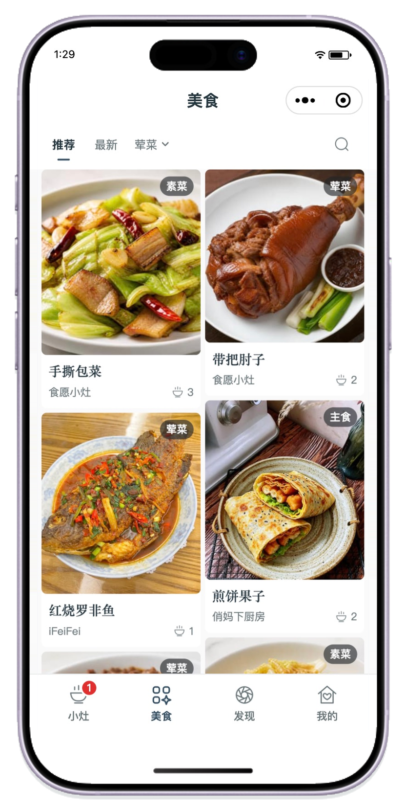
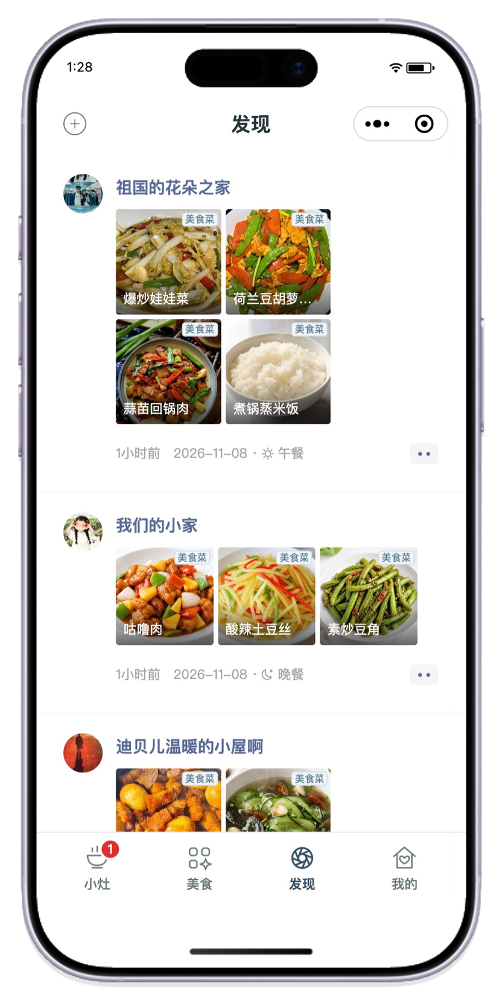
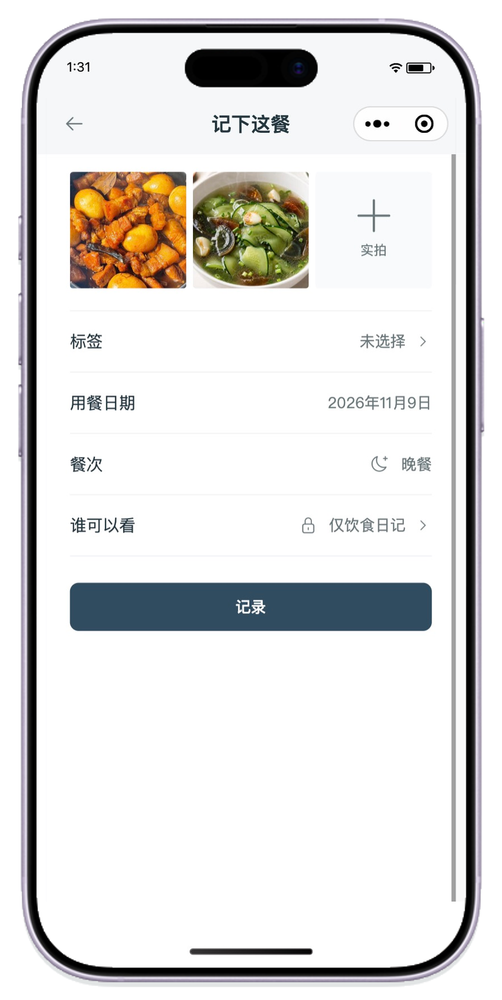
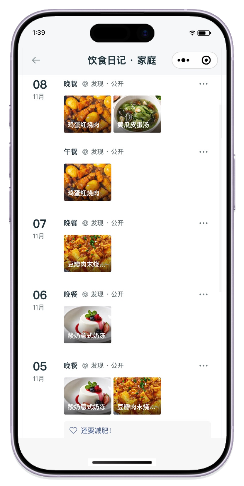
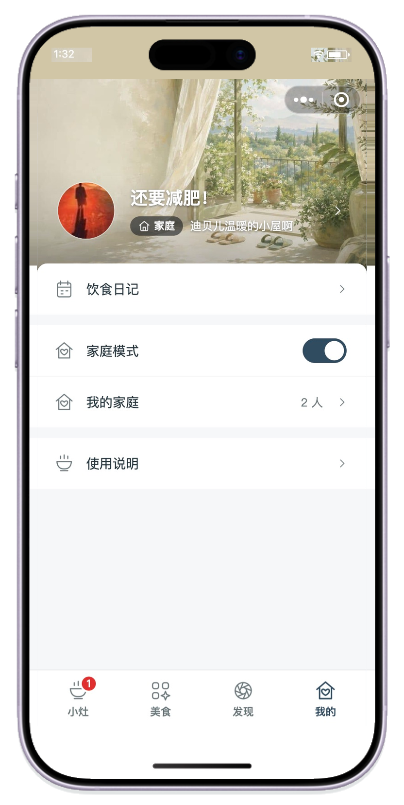

<picture>
  <source media="(max-width: 600px)" srcset="docs/images/promotion/readme-cta-top-compact.png" />
  
</picture>

  <strong>打开微信 → 搜索小程序「食愿小灶」</strong> 
  也可以用微信扫一扫上方小程序码；同一台手机浏览时，可保存<a href="docs/images/promotion/mini-program-code-1280.jpg">小程序码原图</a>，在微信扫一扫中从相册识别。

  
  
  

  <a href="#看看食愿">界面预览</a> ·
  <a href="#一家人的日常">功能介绍</a> ·
  <a href="#体验小程序">小程序体验</a> ·
  <a href="#联系作者">联系作者</a>

> 本公开仓库保留历史源码和项目展示，不再更新后续产品版本。需要了解最新版本或深度定制，欢迎通过文末微信二维码联系作者；公开源码仍可直接获取。

## 关于食愿

> 「今天吃啥？」
> 「都行，你定。」
> 到了晚上，又是同样的问题。

两个人也好，一家人也好，每天吃什么，是一个小问题，却要每天重新做决定。想吃的人一时没有主意，做饭的人除了下厨，还要想菜单、记住大家的口味、确认材料够不够。

**食愿是一款兼顾个人与家庭的饮食规划、菜谱和餐食记录小程序。一个人认真吃饭，一家人一起安排。**

把喜欢的菜收进自家菜单，家人挑选想吃的菜，在「小灶」汇成同一餐，再按菜准备食材。负责点菜的人有具体的选择，负责做饭的人能看到这一餐的安排；菜谱、用量和餐食记录也有了共同的去处。

没有灵感时，就去「美食」看看别人家的拿手菜。喜欢的做法可以加入自家菜单，按家人的口味修改；自己做得好的菜也可以分享出去。

> 把想吃的，变成一起吃的。让好好吃饭这件事，少一些纠结，多一些参与。

## 看看食愿

以下八张图来自已公开的微信真实云数据预览，配有手机边框；截图展示的是历史页面，当前功能请以小程序实际体验为准。点击图片可查看大图。

<table>
  <tr><th>菜单 · 收好想吃的</th><th>安排 · 计划每一餐</th><th>备菜 · 看清用量</th><th>美食 · 寻找灵感</th></tr>
  <tr>
    <td></td>
    <td></td>
    <td></td>
    <td></td>
  </tr>
  <tr><th>发现 · 分享日常</th><th>记录 · 留下这一餐</th><th>日记 · 回看日常</th><th>我的 · 自己与家人</th></tr>
  <tr>
    <td></td>
    <td></td>
    <td></td>
    <td></td>
  </tr>
</table>

## 一家人的日常

### 从想吃，到记下这一餐

**收进菜单 → 安排日期和餐次 → 按菜备料 → 拍照记录 → 回看饮食日记**

- **自己用，也能一起用。** 个人菜单和餐食安排独立；加入家庭后，家人可以在共同的小灶中安排一餐。
- **先把菜记下来。** 创建和整理菜品、套餐，按类别找回喜欢的味道；菜谱中的食材与做法也方便下厨时查看。
- **安排更有着落。** 按日期和餐次选菜，做饭前查看备菜清单和食材用量。
- **从美食寻找灵感。** 浏览公开菜谱，把喜欢的做法加入自己的菜单，也可以分享做得好的菜。
- **把一餐留下来。** 上传实拍或记录安排，在发现中分享日常，也能回看自己的饮食日记。

### 四个入口，各有一件日常事

| 入口 | 能做什么 |
| --- | --- |
| **小灶** | 浏览菜单、创建菜品和套餐、安排餐食、查看备菜清单。 |
| **美食** | 浏览公开菜谱与做法，收藏喜欢的菜。 |
| **发现** | 看看大家正在吃什么，分享自己的餐食。 |
| **我的** | 管理个人资料与家庭，进入饮食日记。 |

## 体验小程序

打开微信搜索 **「食愿小灶」**，也可以扫描下方小程序码。

<picture>
  <source media="(max-width: 600px)" srcset="docs/images/promotion/readme-cta-bottom-compact.png" />
  
</picture>

  <a href="docs/images/promotion/mini-program-code-1280.jpg">查看小程序码</a> ·
  <a href="docs/images/promotion/poster.png">保存宣传海报</a> ·
  <a href="https://github.com/pydaxing/shiyuan/issues/new/choose">反馈使用感受</a>

## 源码与许可

本仓库保留食愿小灶的历史公开源码，后续产品版本在私有仓库持续开发，本公开仓库不再更新产品源码。当前功能请以实际小程序体验为准。历史源码和 [使用说明](docs/开发接手指南.md)可直接查看；软件代码沿用 [MIT License](LICENSE)，使用时请保留原有版权与许可声明。

**版权与素材使用：**「食愿小灶」名称、Logo、小程序码、产品截图、海报和其他图片不随源码按 MIT 授权。欢迎学习参考；未经相应权利人许可，请勿将这些品牌与素材用于商业宣传、冒充官方产品或侵犯他人权益。对侵权使用，权利人保留依法追究责任的权利。详细范围见 [许可说明](LICENSING.md)。

## 联系作者

我是食愿小灶的开发者 pydaxing。欢迎添加我的微信，交流使用体验、反馈建议，或咨询小程序、App 和相关产品的定制化开发。

添加时可以备注「食愿交流」或「定制开发」，并简单说明需求。具体范围、周期与费用另行沟通。

  

历史公开源码可直接从本仓库获取，无需添加微信。
